# 🔔 Awesome Push Notification & Alert Service 🚀

  <strong>Curated directory of top-tier Push Notification platforms, open-source alerting services, and multi-channel messaging infrastructure.</strong>

  
  
  
  
  

---

## 📖 Overview & SEO Keywords 🎯

Welcome to the definitive guide and resource collection for **Push Notification Services**, **Real-Time Alerting Engines**, and **Multi-Channel Notification Infrastructure**. Whether you are building mobile apps on iOS (APNs) and Android (FCM), progressive web apps (Web Push via VAPID), or enterprise event-driven notification pipelines across Email, SMS, WhatsApp, and In-App Feeds, this repository provides battle-tested SaaS tools and open-source self-hosted solutions.

> **Keywords:** *Push Notifications, Alert Service, Web Push, APNs, FCM, Firebase Cloud Messaging, Multi-Channel Messaging, SMS Gateway, Email Alerts, In-App Notification Center, Real-Time Pub/Sub, Notification Infrastructure, Self-Hosted Notifications.*

---

## 📋 Table of Contents 📑

- [📈 Sector Overview & Market Dynamics](#-sector-overview--market-dynamics)
- [🟦 SaaS / Hosted Platforms](#-saas--hosted-platforms)
- [🟩 Open-Source Software](#-open-source-software)
- [📊 Comparison at a Glance](#-comparison-at-a-glance)
- [⭐ Star History](#-star-history)
- [💖 Support & Sponsorship](#-support--sponsorship)
- [🤝 Contributing](#-contributing)
- [📄 License](#-license)

---

## 📈 Sector Overview & Market Dynamics 🌐

The global push notification software and real-time messaging market is currently estimated at approximately **$4.0 billion to $5.5 billion** and is projected to expand at a compound annual growth rate (**CAGR**) of **10.6% to 15.8%**, surpassing **$12 billion** by the early 2030s, driven by surging mobile-first commerce, web push adoption, and AI-orchestrated personalized engagement.

The industry exhibits a **moderately fragmented** structure: while hyperscale cloud infrastructure providers (such as Google FCM and Apple APNs) handle underlying zero-cost OS-level transport, the application layer is split between multi-billion-dollar enterprise customer engagement suites (like Braze, Salesforce, and Airship), agile developer-first notification APIs (such as OneSignal, Courier, and MagicBell), and vibrant self-hosted open-source alternatives (like Novu and ntfy).

---

## 🟦 SaaS / Hosted Platforms ☁️

Commercial, cloud-hosted Push Notification and Alert Service platforms. The table below is sorted by company size (**Valuation / Market Cap / Revenue** descending) and provides exact starting tiers, free-for-ever quotas, and trial durations.

| Rank | Platform | Valuation / Company Scale 🏢 | Starting Paid Tier 💳 | Free Forever Tier Limit 🎁 | Supported Channels 📡 | Primary Strength 💡 |
|:---:|:---|:---|:---|:---|:---|:---|
| 1 | **Firebase Cloud Messaging (FCM)** | **~$3.6T+ Market Cap** *(Alphabet / Google)* | Free infrastructure; pay-as-you-go via Google Cloud Blaze plan ($0 for standard push) | **100% Free Forever** (Unlimited push notifications to Android, iOS & Web) | Push (APNs / Web Push / Android) | Native Google/Android push delivery at scale |
| 2 | **Zoho Catalyst Push Notifications** | **~$12B Valuation** *(~$1.5B+ Annual Revenue)* | **$0.00002 per notification** after free tier | **500 notifications/month** free forever | Web Push & App Notifications | Tight serverless integration within Zoho ecosystem |
| 3 | **Braze** | **$5.66B Valuation** *(Salesforce buyout agreement; ~$738M+ ARR)* | **~$30,000/year** (Custom annual contract starting tier based on MAUs) | **No Free Forever Tier** (Pilot / proof-of-concept trial via sales, typically 14–30 days) | Push, In-App, Email, SMS, WhatsApp, Webhooks | Enterprise-grade journey orchestration & analytics |
| 4 | **Pusher (Beams & Channels)** | **$35M Acquisition** *(Acquired by Bird / MessageBird, valued at ~$3B)* | **$29/month** *(Sandbox paid upgrade starting tier)* | **1,000 Monthly Active Devices** & 100 concurrent WebSocket connections free forever | Real-time WebSockets, Web & Mobile Push | Real-time bidirectional messaging & event fan-out |
| 5 | **OneSignal** | **~$250M–$500M Valuation** *(~$20M–$50M Revenue; $84M raised)* | **$19/month base** + $0.012/MAU (Growth plan) | **10,000 subscribers / MAU** free forever with unlimited mobile push | Push (Web & Mobile), Email, SMS, In-App | Accessible entry point with generous free tier & rich SDKs |
| 6 | **Airship** | **~$55M–$60M Revenue** *($100M+ funding raised)* | **~$1,000/month** (Annual starter commitments starting ~$12,000/year) | **No Free Forever Tier** (Free trial available on request via sales, typically 14–30 days) | Mobile Push, Web Push, In-App, SMS, Email, Wallet | Enterprise mobile customer experience & journey automation |
| 7 | **Courier** | **~$57M Total Funding** *(Series B stage; Y Combinator alum)* | **$0.005 per notification** (Pay-as-you-go Business tier) | **10,000 sends/month** free forever | Push, Email, SMS, Slack, Teams, In-App Chat | Unified notification routing API across all providers |
| 8 | **MagicBell** | **~$20M Valuation** *(~$2M–$4.5M funding raised; Y Combinator)* | **$249/month** (Startup tier for 50,000 deliveries; overage $0.0025/delivery) | **1,000 deliveries/month** free forever (Builder tier) | In-App Inbox, Mobile Push, Email, SMS, Slack | Drop-in embeddable notification inbox component |
| 9 | **WonderPush** | **Acquired by Brevo** *(formerly Sendinblue)* | **€1/month base + €1 per 1,000 subscribers/month** | **14-day Free Trial** (Full access, no credit card required; thereafter €1/1k subscribers) | Web Push, Mobile Push, In-App Messages | Predictable subscriber-based pricing with zero feature gates |

---

## 🟩 Open-Source Software 💻

Self-hosted, community-driven Push Notification and Alert Service tools. Sorted by **GitHub Star Count** (descending). Each project includes a live social star badge linking directly to its GitHub stargazers.

| Rank | Project | Stars ⭐ | Stack 🛠️ | License 📜 | Description 📝 |
|:---:|:---|:---:|:---|:---:|:---|
| 1 | **[Novu](https://github.com/novuhq/novu)** |  | TypeScript, NestJS, MongoDB, Redis | MIT | Complete open-source notification infrastructure featuring a visual workflow designer, digest engine, user preference center, and embeddable in-app inbox components for React, Vue, and Angular. |
| 2 | **[ntfy](https://github.com/binwiederhier/ntfy)** |  | Go, Kotlin (Android), Swift (iOS) | Apache-2.0 / GPL-2.0 | Ultra-simple HTTP-based pub/sub notification service. Send instant push notifications to your phone or desktop via simple `curl` commands, scripts, or WebSockets. |
| 3 | **[Apprise](https://github.com/caronc/apprise)** |  | Python | MIT | Universal push notification gateway library for Python and CLI. Delivers instant alerts to over 90+ services including Telegram, Discord, Slack, Pushover, Twilio, and desktop notifications. |
| 4 | **[Gotify](https://github.com/gotify/server)** |  | Go, Java, Vue.js | MIT | Lightweight self-hosted push notification server with built-in WebSockets, responsive web UI, command-line client, and an official open-source Android app. |
| 5 | **[Pushpin](https://github.com/fastly/pushpin)** |  | C++, Rust | Apache-2.0 | High-performance reverse proxy for real-time WebSocket, HTTP streaming, and Web Push push notification architectures, enabling scalable server-to-client event streaming. |
| 6 | **[web-push](https://github.com/web-push-libs/web-push)** |  | Node.js, JavaScript | MIT | Reference implementation of the W3C Web Push protocol for Node.js. Handles VAPID authentication, payload encryption (RFC 8291), and direct dispatch to browser push endpoints. |

---

## 📊 Comparison at a Glance 🔍

| Solution | Deployment Type | Primary Architecture | Free Tier / Trial | Multi-Channel Capabilities | Best Suited For |
|:---|:---:|:---:|:---|:---:|:---|
| **Novu** | Self-Hosted / Hybrid Cloud | TypeScript + Docker Compose | ✅ 100% Free Self-Host | ✅ Push, Email, SMS, Chat, In-App | Engineering teams seeking full notification control |
| **ntfy** | Self-Hosted / SaaS (`ntfy.sh`) | Go standalone binary / Docker | ✅ Free public tier & OSS | ✅ HTTP Push, WebSockets | Developers, DevOps scripts, cron jobs, home automation |
| **Gotify** | Self-Hosted | Go + SQLite / Docker | ✅ 100% Free Self-Host | ⚠️ Push & WebSockets only | Minimalist private alert servers & private homelabs |
| **Apprise** | Self-Hosted Library / CLI | Python package / REST API | ✅ 100% Free Self-Host | ✅ 90+ endpoints (Slack, SMS, Discord) | Universal dispatch from Python pipelines & scripts |
| **OneSignal** | Managed Cloud (SaaS) | Multi-tenant SaaS | ✅ 10,000 subscribers | ✅ Push, Email, SMS, In-App | Startups & web apps needing instant multi-channel scale |
| **Firebase FCM** | Managed Cloud (PaaS) | Google Cloud Infrastructure | ✅ Free unlimited push | ⚠️ OS push transport only | Android, iOS, and Web developers using native SDKs |
| **Braze** | Enterprise SaaS | Cloud SaaS | ❌ Annual contract only | ✅ Omnichannel journeys | Large enterprises with sophisticated marketing teams |
| **Courier** | Managed Cloud API | API gateway | ✅ 10,000 sends/month | ✅ Routing across multiple vendors | Teams wanting to aggregate multiple notification APIs |
| **MagicBell** | Managed Cloud | Embeddable React/JS widget | ✅ 1,000 deliveries/month | ✅ In-app feed + Push + Email | SaaS applications requiring an out-of-the-box user inbox |
| **WonderPush** | Managed Cloud (SaaS) | Cloud SaaS | ⏳ 14-day free trial | ✅ Web & Mobile Push, In-App | Predictable subscriber-tiered commercial push |

---

## ⭐ Star History 📈

---

## 💖 Support & Sponsorship ☕

If you found this curated directory helpful for selecting your push notification infrastructure or saved time on architectural research, please consider supporting the project:

- ⭐ **Star this repository** to help others discover it on GitHub.
- 🍴 **Fork and contribute** new open-source tools or corrections.
- 📢 **Share with fellow developers** on Twitter, LinkedIn, Reddit, or Discord.
- ☕ **Buy me a coffee / Sponsor the project**: Support ongoing maintenance and curation on the [GitHub Sponsor Dashboard](https://github.com/sponsors/ishandutta2007).

---

## 🤝 Contributing 🚀

Contributions are warmly welcomed! If you know of an active open-source push notification system, alerting tool, or developer library that belongs on this list:

1. Fork this repository.
2. Ensure the repository has regular commits (active within the past 12 months) and valid open-source licensing.
3. Open a Pull Request with a clear description of why the tool stands out.

Please review our [contributing guidelines](https://github.com/ishandutta2007/Awesome-Awesome-Awesome) for more details.

---

## 📄 License ⚖️

This curated compilation is released under the **[Creative Commons CC0 1.0 Universal (Public Domain)](./LICENSE)**. All individual software tools, logos, and platforms mentioned retain their respective trademarks, copyrights, and licenses.
